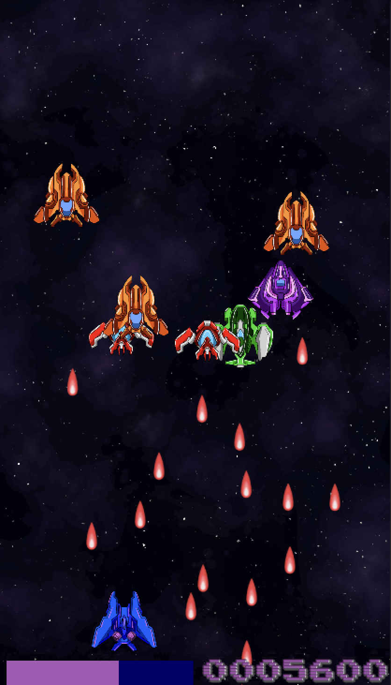

# Star Blaster

**[▶ Play in your browser](https://isasebib.itch.io/star-blaster)**



A fast-paced 2D space shooter built with **Unity 6** and **C#**. Pilot your ship, blast through waves of enemy fighters, and survive as long as you can. Playable on desktop and mobile with simple one-finger controls.

## Features

- **One-finger controls:** on mobile, drag anywhere and the ship follows your finger while firing automatically. Built on Unity's Input System, with keyboard support on desktop (WASD to move, Space to shoot).
- **Data-driven enemy waves:** each wave is a **ScriptableObject** that defines the enemy prefabs, the path they follow, and their move speed, so new waves can be created without touching code.
- **Waypoint pathing:** enemies spawn at the first waypoint and travel along a path made of child objects, then despawn at the end.
- **Responsive play area:** the ship's movement bounds are calculated from the camera viewport, so they adapt to any screen size and aspect ratio.
- **Health, score and game over flow:** live HP bar and score, hit particles, damage and death sound effects, and a final score screen with Play Again.
- **Frame-rate independent movement:** movement uses `Time.deltaTime`, so the game feels the same at any frame rate.
- **Web build:** exported to WebGL and hosted on itch.io.

## Controls

| Platform | Controls |
|----------|----------|
| Mobile | Touch and drag, ship follows your finger and auto-fires |
| Desktop | Click and hold to follow the cursor, or WASD to move and Space to shoot |

## Getting Started

1. Clone the repository:
   ```bash
   git clone https://github.com/isasebib/Star-Blaster.git
   ```
2. Open the project with **Unity 6** through Unity Hub.
3. Open the game scene from `Assets/Scenes` and press **Play**.

## Built With

- Unity 6
- C#
- Unity Input System
- TextMeshPro

## Author

**İsa** · [Portfolio](https://isasebib.github.io) · [itch.io](https://isasebib.itch.io)
